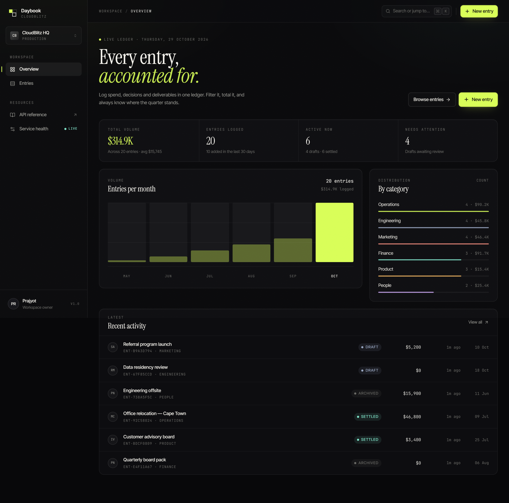
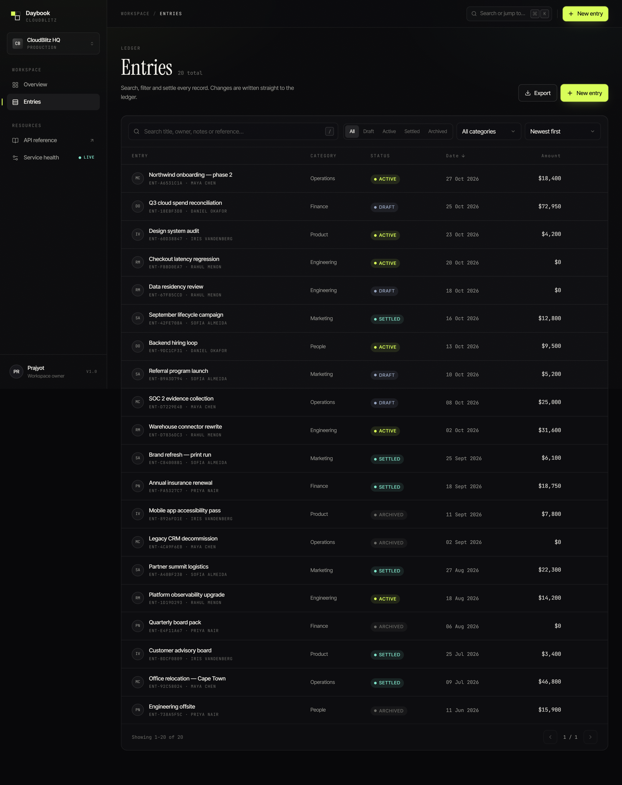
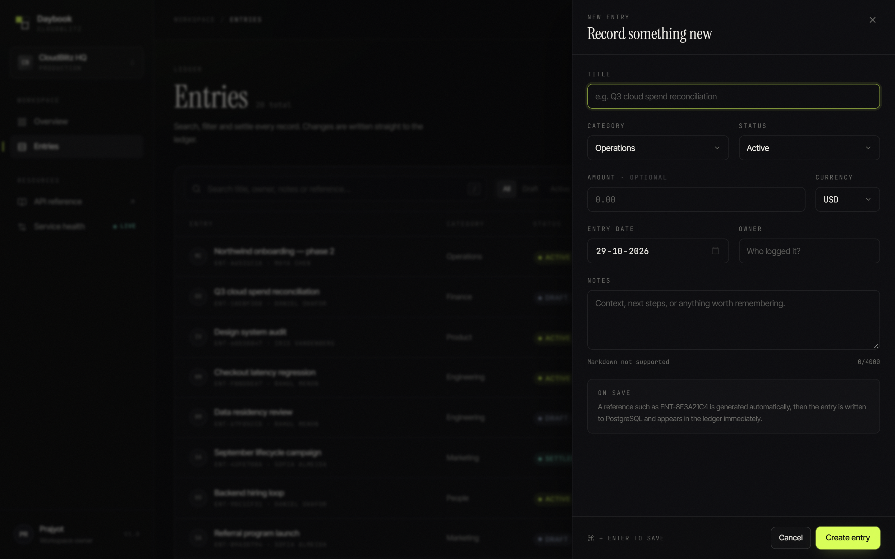

# Daybook

**The CloudBlitz entry ledger.** A production-shaped app: **React** front end, **Spring Boot** API, **PostgreSQL** storage,
deployed as a single **Amazon ECS (Fargate)** task behind an ALB.



## What it does

- Create, edit and delete entries with a generated reference (`ENT-8F3A21C4`), category, status,
  amount, currency, owner and notes.
- Server-side search across title, notes, owner and reference; filters for status, category and date
  range; sorting on any whitelisted column; pagination.
- Dashboard with totals, 30-day activity, a six-month volume chart and category distribution.
- Keyboard-first: `⌘K` command palette, `N` for a new entry, `/` to focus search, `⌘↵` to save.
- Optimistic-feeling UI with query invalidation, toasts, inline validation and a two-step delete.

| Entries | Entry editor |
| --- | --- |
|  |  |

## Stack

| Layer | Choice |
| --- | --- |
| Front end | React 18, TypeScript, Vite 5, Tailwind CSS, TanStack Query v5, React Router 6 |
| API | Java 21, Spring Boot 3.3, Spring Data JPA, Bean Validation, springdoc OpenAPI |
| Database | PostgreSQL 16 (Amazon RDS), Flyway migrations, Hibernate `validate` in prod |
| Hosting | ECS Fargate (nginx + JVM sidecar in one task), ALB, ECR, CloudWatch Logs |
| Local dev | H2 in-memory with seeded data, no Docker required |

## Quick start

Prerequisites: JDK 21, Node 20+. Maven is provided via `./mvnw`.

```bash
# 1. API — http://localhost:8080 (H2 in-memory, 20 demo entries)
cd backend
./mvnw spring-boot:run

# 2. Web — http://localhost:5173 (Vite proxies /api to :8080)
cd frontend
npm install
npm run dev
```

Useful URLs while the API is running:

- Swagger UI — <http://localhost:8080/swagger-ui.html>
- Health — <http://localhost:8080/actuator/health>
- H2 console — <http://localhost:8080/h2-console> (JDBC URL `jdbc:h2:mem:entries`, user `sa`)

### Run the production shape locally

```bash
cp .env.example .env
docker compose up --build
# web → http://localhost:3000, api → http://localhost:8080
```

This uses PostgreSQL 16 and the `prod` profile: Flyway migrates the schema and Hibernate validates
the entity mapping against it, exactly as on RDS.

## API

Base path `/api`.

| Method | Path | Description |
| --- | --- | --- |
| `GET` | `/entries` | Paginated search. `q`, `status`, `category`, `from`, `to`, `minAmount`, `maxAmount`, `page`, `size`, `sortBy`, `direction` |
| `GET` | `/entries/{id}` | Single entry |
| `POST` | `/entries` | Create — `201` with `Location` |
| `PUT` | `/entries/{id}` | Replace |
| `DELETE` | `/entries/{id}` | Delete — `204` |
| `GET` | `/entries/stats` | Dashboard aggregates |
| `GET` | `/entries/meta` | Category and status vocabulary for the UI |

Errors use RFC 7807 `application/problem+json`. Validation failures include a field map:

```json
{
  "title": "Validation failed",
  "status": 400,
  "detail": "One or more fields are invalid",
  "errors": { "title": "Title is required" }
}
```

### Data model

```
entries
  id          uuid          pk
  reference   varchar(24)   unique, generated at insert
  title       varchar(160)  not null
  category    varchar(32)   OPERATIONS | FINANCE | ENGINEERING | PRODUCT | MARKETING | PEOPLE | OTHER
  status      varchar(16)   DRAFT | ACTIVE | SETTLED | ARCHIVED
  amount      numeric(14,2) nullable
  currency    varchar(3)    default USD
  entry_date  date          not null
  owner       varchar(80)
  notes       varchar(4000)
  created_at  timestamptz
  updated_at  timestamptz
  version     bigint        optimistic locking
```

Indexes cover `entry_date`, `created_at`, `status`, `category`, `lower(title)` and the unique
`reference`.

## Configuration

| Variable | Default | Used by |
| --- | --- | --- |
| `APP_PORT` | `8080` | API |
| `SPRING_PROFILES_ACTIVE` | `dev` | API |
| `DB_HOST` / `DB_PORT` / `DB_NAME` | `localhost` / `5432` / `entries` | API (prod) |
| `DB_USERNAME` / `DB_PASSWORD` | `entries` | API (prod) |
| `DB_POOL_SIZE` | `10` | API (prod) |
| `CORS_ALLOWED_ORIGINS` | `http://localhost:5173` | API |
| `VITE_API_BASE_URL` | `/api` | Web build |

## Tests

```bash
cd backend && ./mvnw test        # 7 tests
cd frontend && node scripts/e2e.mjs   # browser E2E (needs both servers running)
```

- `EntryApiTest` — create, validate, search, stats, delete, 404 (H2).
- `PostgresSchemaTest` — boots the **prod** profile against an embedded PostgreSQL: Flyway applies
  `V1`, Hibernate validates the mapping, a row round-trips.
- `scripts/e2e.mjs` — drives Chrome through create → search → filter → update → delete → validation
  and asserts against the API.

## Project layout

```
backend/
  src/main/java/com/cloudblitz/entries/
    api/            controller, DTOs, problem-details handler
    config/         CORS, OpenAPI, demo seeder (dev only)
    domain/         Entry entity + enums
    repository/     Spring Data repository + aggregates
    service/        query building, stats, validation of business rules
  src/main/resources/db/migration/V1__create_entries.sql
frontend/
  src/components/   sidebar, topbar, entry sheet, palette, chart, toasts
  src/pages/        overview, entries
  src/lib/          typed API client, formatting, shell context
infra/
  ecs-task-definition.json   api + web containers, logs, health checks
  README.md                  RDS, IAM, ECR, ALB, ECS walkthrough
scripts/deploy.sh            build → push → register → roll out
docker-compose.yml           local production-shaped stack
```

## Deployment

See [`infra/README.md`](infra/README.md) for the full AWS walkthrough. In short:

```bash
export AWS_REGION=ap-south-1 CLUSTER=cloudblitz-prod SERVICE=entries \
       DB_HOST=cloudblitz-daybook.xxxx.rds.amazonaws.com \
       CORS_ORIGINS=https://entries.example.com
./scripts/deploy.sh
```

The ALB terminates TLS and forwards to nginx on port 80; nginx serves the SPA and proxies `/api`
over loopback to the Spring Boot container, so the database credentials and the JVM port never
leave the task.
